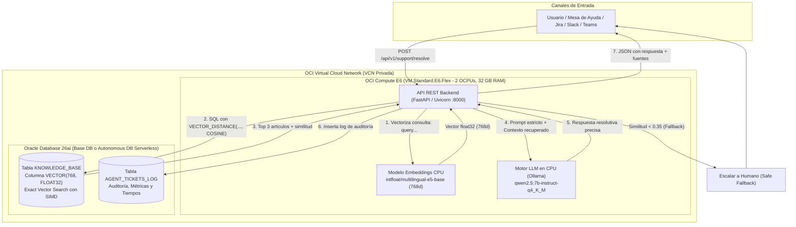

# Oracle-VectorDesk 🛡️🤖

[](https://www.oracle.com/database/)
[-F80000?logo=oracle&logoColor=white)](https://cloud.oracle.com)
[](https://fastapi.tiangolo.com)
[](https://ollama.com)
[-blue)](https://huggingface.co/intfloat/multilingual-e5-base)
[](https://opensource.org/licenses/MIT)

> **Agente autónomo de soporte técnico empresarial y Helpdesk de Nivel 1** con arquitectura RAG (*Retrieval-Augmented Generation*), impulsado de forma nativa por **Oracle Database 26ai (AI Vector Search)** e inferencia local en CPU sobre **Oracle Cloud Infrastructure (OCI)**. 
> 
> **Ultra bajo costo:** Operación mensual predecible desde **$100.76 USD / mes** (en base de datos existente / BYOL) hasta **$421.60 USD / mes** (infraestructura dedicada 100% nueva en OCI), sin requerir costosas GPUs ni cargos por token de terceros.

---

## 🌟 Características Principales

* **"Bring AI to the Data":** Todo el conocimiento corporativo reside y se consulta dentro de Oracle Database 26ai mediante columnas nativas `VECTOR(768, FLOAT32)` y la función `VECTOR_DISTANCE(..., COSINE)`. Los datos sensibles de la empresa nunca viajan a nubes de terceros ni a bases de datos vectoriales externas.
* **100% Inferencia en CPU (Sin GPUs):** Ejecuta **Qwen 2.5 7B Instruct** cuantizado (Q4_K_M) sobre procesadores AMD EPYC en instancias `VM.Standard.E6.Flex`, manteniendo costos fijos y predecibles.
* **Tolerancia Cero a la Alucinación:** Incorpora un umbral estricto de similitud semántica (`similarity < 0.35`). Si la consulta del usuario no tiene respaldo documental comprobado en Oracle, el agente **no inventa** y escala automáticamente el caso a soporte humano.
* **Auditoría Empresarial Nativa:** Cada interacción, latencia en milisegundos, nivel de confianza y contexto recuperado se persiste automáticamente en la tabla `AGENT_TICKETS_LOG`.
* **Wizard Interactivo de Instalación:** Incluye `install.py` para validar conectividad con el DBSystem, configurar variables, crear DDLs vectoriales e ingestar datos en minutos.
* **Dataset Demo Completo:** Generador de 10 documentos PDF corporativos y suite automatizada de benchmark con 20 preguntas reales para evaluar precisión y tiempos de respuesta.

---

## 📐 Diagrama de Arquitectura



---

## 💰 Análisis y Desglose de Costos en OCI (Validado con OCI Cost Estimator)

A diferencia de soluciones tradicionales de IA que exigen GPUs dedicadas (A100/H100) con costos superiores a los \$1,500 - \$3,000 USD mensuales, **Oracle-VectorDesk** opera sobre una arquitectura plana y predecible en OCI:

| Componente OCI | Especificación Técnica | Utilización | Costo Mensual Estimado |
| :--- | :--- | :---: | :---: |
| **OCI Compute (AMD E6)** | `VM.Standard.E6.Flex` (2 OCPUs / 4 vCPUs, 32 GB RAM) | 744 hrs / mes | **\$92.26 USD** |
| **Boot Volume** | 200 GB Balanced (VPU 10) | 744 hrs / mes | **\$8.50 USD** |
| **Subtotal Cómputo + Almacenamiento VM** | *Capa de inferencia CPU y API* | | **\$100.76 USD** |
| **Opción A: Oracle Base Database Service (VM)** | Standard Edition (4 ECPUs, 256 GB Storage) | 744 hrs / mes | **\$320.85 USD** |
| **Opción B: Autonomous AI Database (Serverless)** | Workload: *Vector Database* (2 ECPUs, 200 GB Storage) | 744 hrs / mes | **\$177.08 USD** |
| | | | |
| 🚀 **Total Greenfield Opción A (VM Base DB + Compute)** | *Base de Datos 26ai en VM dedicada + Cómputo E6* | | **\$421.60 USD / mes** |
| ⚡ **Total Greenfield Opción B (Autonomous Vector DB + Compute)** | *Autonomous AI Vector Database Serverless + Cómputo E6* | | **\$277.84 USD / mes** |
| 💡 **Total para Clientes con BD Oracle Existente / BYOL** | *Aprovechando su DB actual ("Bring AI to Data")* | | **\$100.76 USD / mes** |

> **Nota de Negocio:** 
> * **PoC Validado en Laboratorio:** La implementación actual de referencia de este repositorio fue desplegada y validada sobre **Oracle Base Database Service (VM)** con conectividad directa por VCN privada.
> * **Flexibilidad Multimodelo:** El conector de datos (`src/database.py`) ya incluye soporte nativo para **Oracle Autonomous Database** mediante mTLS (Wallets / `cwallet.sso`), permitiendo a cualquier cliente desplegar sobre Serverless (*Vector Database Workload*) para reducir el costo total a solo **$277.84 USD/mes** con cero mantenimiento de infraestructura.
> * Para empresas que ya cuentan con un DBSystem o Exadata en OCI, el costo incremental es únicamente la instancia Compute E6 (**~$100.76 USD/mes**).

### 1. Prerrequisitos en OCI
* **Base de Datos:** Oracle Database 26ai o 23ai (Base DB Service o Autonomous Database) accesible por la VCN.
* **Instancia Compute:** `VM.Standard.E6.Flex` (Oracle Linux 10, 2 OCPUs, 32 GB RAM).

```bash
# En la máquina Compute: instalar Ollama y el modelo Qwen 2.5 7B
curl -fsSL https://ollama.com/install.sh | sh
ollama pull qwen2.5:7b-instruct-q4_K_M

# Abrir el puerto 8000 en el firewall del sistema operativo
sudo firewall-cmd --permanent --add-port=8000/tcp
sudo firewall-cmd --reload
```

### 2. Clonar el Repositorio
```bash
git clone https://github.com/tipsforcloud/Oracle-VectorDesk.git
cd Oracle-VectorDesk
```

### 3. Ejecutar el Asistente Interactivo de Instalación 🧙‍♂️
El asistente guiará paso a paso la conexión con el DBSystem, la creación de las tablas vectoriales y la ingesta inicial:

```bash
# Recomendado: instalar PyTorch CPU antes de dependencias pesadas
pip3 install --break-system-packages torch --index-url https://download.pytorch.org/whl/cpu

# Iniciar el Setup Wizard
python3 install.py
```

### 4. Cargar tus Propios Documentos PDF (Producción)
Para que el agente responda sobre la documentación real de tu empresa:
1. Copia tus archivos `.pdf` en la carpeta `data/documents/`:
   ```bash
   cp /ruta/a/tus/manuales/*.pdf data/documents/
   ```
2. Ejecuta el script de ingesta:
   ```bash
   python3 scripts/ingest_documents.py
   ```
   *El script extraerá el texto, generará los embeddings de 768 dimensiones en CPU y almacenará los vectores directamente en la tabla `KNOWLEDGE_BASE` de tu Oracle Database 26ai.*

### 5. Iniciar el Servidor de Soporte

#### Opción A: Ejecución Directa en Primer Plano
```bash
python3 run.py
```

#### Opción B: Servicio en Segundo Plano para Producción (systemd)
Si deseas que el agente corra de forma autónoma, arranque tras reinicios y se administre como servicio del sistema operativo:

```bash
# Registrar y arrancar el servicio en segundo plano
sudo python3 scripts/setup_systemd_service.py
```

*Comandos para administrar el servicio:*
* **Ver estado:** `sudo systemctl status oracle-vectordesk`
* **Ver logs en tiempo real:** `sudo journalctl -u oracle-vectordesk -f`
* **Reiniciar servicio:** `sudo systemctl restart oracle-vectordesk`
* **Detener servicio:** `sudo systemctl stop oracle-vectordesk`

---

## 🧪 Pruebas y Validación

### Probar Salud del Servicio
```bash
curl http://localhost:8000/health
```
```json
{
  "status": "ok",
  "database": "Oracle Database 26ai AI Vector Search",
  "embedding_model": "intfloat/multilingual-e5-base (768 dims)",
  "llm_model": "qwen2.5:7b-instruct-q4_K_M"
}
```

### Resolver un Ticket Real
```bash
curl -X POST http://localhost:8000/api/v1/support/resolve \
  -H "Content-Type: application/json" \
  -d '{
    "ticket_id": "TCK-1001",
    "user_query": "¿Cuál es la línea telefónica y el código PIN de emergencia para activar la guardia de soporte crítico fuera de horario?"
  }'
```

*Respuesta:*
```json
{
  "ticket_id": "TCK-1001",
  "user_query": "¿Cuál es la línea telefónica y el código PIN de emergencia para activar la guardia de soporte crítico fuera de horario?",
  "suggested_resolution": "Para activar la guardia de soporte crítico en incidentes de Severidad 1 (P1) fuera de horario, se debe marcar la línea internacional +1-800-555-0199 e ingresar el PIN de emergencia 9911.\n\nSi necesitas asistencia adicional, comunícate con la línea del SOC en la ext. 9111.",
  "confidence_score": 0.8807,
  "sources": [
    {
      "id": 9,
      "title": "Horarios Guardias Escalamiento Soporte Critico",
      "similarity": 0.8807
    }
  ],
  "execution_time_ms": 32150
}
```

### Ejecutar el Benchmark Completo (20 Preguntas)
```bash
python3 scripts/run_benchmark.py
```

---

## 📂 Estructura del Proyecto

```text
Oracle-VectorDesk/
├── src/                          # Núcleo modular de la aplicación
│   ├── config.py                 # Configuración centralizada
│   ├── database.py               # Capa de datos Oracle 26ai y vector search
│   ├── embeddings.py             # Generación de embeddings 768d en CPU
│   ├── llm.py                    # Integración con Ollama (Qwen 2.5 7B)
│   ├── models.py                 # Esquemas Pydantic
│   └── agent.py                  # API REST FastAPI y orquestación RAG
│
├── sql/                          # Scripts SQL DDL
│   └── init_db.sql               # Inicialización de tablas y columnas VECTOR
│
├── scripts/                      # Herramientas operativas
│   ├── generate_demo_pdfs.py     # Generador de 10 PDFs de prueba con ReportLab
│   ├── ingest_documents.py       # Ingesta y vectorización de PDFs propios o demo
│   ├── run_benchmark.py          # Evaluador automatizado de 20 preguntas
│   └── setup_systemd_service.py  # Instalador del servicio systemd en segundo plano
│
├── service/                      # Plantillas de servicios del sistema operativo
│   └── oracle-vectordesk.service.template
│
├── data/                         # Datasets y documentos
│   ├── documents/                # 📂 Directorio para subir PDFs del cliente
│   ├── demo_docs/                # Almacén de PDFs de demostración
│   └── benchmark_questions.json  # 20 preguntas de evaluación
│
├── docs/                         # Documentación técnica
│   └── deployment_guide.md       # Manual completo y Troubleshooting
│
├── install.py                    # Asistente interactivo de instalación (Setup Wizard)
├── run.py                        # Script de inicio del servidor FastAPI
├── requirements.txt              # Dependencias de Python
├── .env.example                  # Plantilla de variables de entorno
├── .gitignore                    # Reglas de exclusión de Git
├── LICENSE                       # Licencia MIT
└── README.md                     # Documentación principal
```

---

## 📄 Licencia
Este proyecto se distribuye bajo la licencia **MIT**. Consulta el archivo [LICENSE](LICENSE) para más información.
